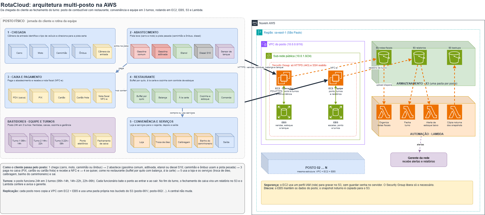

<div align="center">

# RotaCloud
### Arquitetura conceitual de uma rede de postos de combustíveis na AWS

**Da chegada do cliente ao fechamento do turno: uma visão integrada da operação física e dos recursos em nuvem.**


</div>

---

## Visão geral

O **RotaCloud** é um exercício de arquitetura conceitual desenvolvido no contexto da formação **AWS Cloud Foundations**, com foco inicial no gerenciamento de instâncias Amazon EC2 e nos fundamentos de armazenamento em nuvem.

O projeto utiliza como cenário uma rede de postos de combustíveis com operação 24 horas, atendimento a veículos leves e pesados, restaurante, conveniência e equipes organizadas em três turnos.

A proposta é representar como uma operação física pode utilizar recursos da AWS para apoiar aplicações, armazenar documentos e relatórios e automatizar rotinas administrativas.

> **Escopo:** este repositório documenta uma proposta de arquitetura para fins educacionais. Não representa uma infraestrutura implantada, não contém integração real com bombas ou meios de pagamento e não comprova execução de serviços ou testes na AWS.

## O cenário de negócio

O complexo rodoviário considerado no estudo reúne diferentes jornadas e rotinas operacionais:

| Área | Atividades representadas |
|---|---|
| Chegada e direcionamento | Identificação do tipo de veículo e encaminhamento para a pista adequada |
| Abastecimento | Atendimento a carros, motos, caminhões e ônibus, com diferentes combustíveis |
| Caixa e pagamento | Registro do abastecimento, pagamento por diferentes meios e emissão de NFC-e |
| Restaurante | Buffet por quilo, balança, serviço à la carte, cozinha, estoque e comanda |
| Conveniência e serviços | Loja, troca de óleo, calibragem e banho para caminhoneiros |
| Equipe e turnos | Rotina 24 horas, registro de ponto e fechamento de caixa |

O cenário foi escolhido para dar contexto aos recursos de computação, armazenamento e automação estudados. Os setores físicos representam o domínio do negócio; não são, por si só, componentes ou serviços da AWS.

## Diagrama da arquitetura

O desenho apresenta duas perspectivas complementares:

1. **Operação física:** jornada do cliente e rotina da equipe no posto.
2. **Infraestrutura em nuvem:** recursos AWS propostos para apoiar as aplicações e as rotinas administrativas.



*O arquivo-fonte editável do diagrama poderá ser disponibilizado junto à imagem exportada.*

## Como a arquitetura está organizada

### 1. Amazon EC2 — capacidade computacional

O Amazon Elastic Compute Cloud (Amazon EC2) fornece instâncias de máquinas virtuais para executar aplicações.

Na proposta, foram representadas duas instâncias com responsabilidades distintas:

- **EC2 — Operação:** aplicações relacionadas ao atendimento, vendas, abastecimento e conveniência.
- **EC2 — Equipe:** aplicações de apoio aos funcionários, registro de ponto, turnos e relatórios.

A separação é uma decisão de modelagem do cenário, utilizada para ilustrar a execução de diferentes cargas de trabalho em instâncias EC2. Não significa que essa seja a única arquitetura possível ou que a divisão já tenha sido validada por dimensionamento.

A escolha de uma instância deve considerar as características da aplicação, como processamento, memória, armazenamento, rede e sistema operacional. A imagem de máquina (AMI) fornece a base para iniciar a instância.

### 2. Amazon EBS — armazenamento em blocos associado à EC2

O Amazon Elastic Block Store (Amazon EBS) fornece volumes de armazenamento em blocos que podem ser anexados às instâncias EC2.

No RotaCloud, os volumes EBS representam o armazenamento associado às aplicações de operação e de equipe, incluindo dados de trabalho, arquivos e registros que precisam estar disponíveis para as instâncias.

A analogia utilizada no conteúdo da formação é a de um disco adicional conectado a uma máquina virtual: o volume pode ser dimensionado e utilizado pela instância como armazenamento persistente.

**Ponto importante:** EBS não é apresentado aqui como um banco de dados ou como um serviço de armazenamento de objetos. Ele fornece volumes em blocos para uso pela EC2. A arquitetura lógica do banco de dados da aplicação não faz parte do escopo deste primeiro desenho.

### 3. Amazon S3 — armazenamento de objetos

O Amazon Simple Storage Service (Amazon S3) é utilizado na proposta para armazenar objetos, como documentos e arquivos gerados pelas rotinas do posto.

O desenho separa os usos por finalidade:

- **Notas fiscais:** arquivos relacionados à documentação fiscal.
- **Relatórios:** relatórios operacionais e de fechamento de turno.
- **Backups:** cópias de arquivos previstas na estratégia conceitual de proteção de dados.

A separação por finalidade facilita a compreensão e a organização dos dados. Em uma implementação real, nomes de buckets, prefixos, políticas de acesso, retenção e requisitos legais precisariam ser definidos.

O S3 também oferece classes de armazenamento e regras de ciclo de vida (*Lifecycle*), que podem movimentar objetos entre classes conforme critérios de acesso e retenção. O uso dessas opções depende da frequência de consulta e dos requisitos de recuperação.

### 4. AWS Lambda — automação de rotinas

O AWS Lambda aparece no desenho como proposta de automação de tarefas pontuais:

- Organização de documentos fiscais.
- Apoio ao fechamento de turno.
- Alerta de estoque baixo.
- Orquestração de uma rotina relacionada à cópia de snapshots.

Esses itens representam **casos de uso propostos**, e não funções implementadas ou testadas.

Uma função Lambda executa código em resposta a eventos ou invocações. Para que cada rotina funcione, ainda seria necessário definir sua origem de dados, evento de acionamento, permissões e integração com os demais recursos.

O desenho é introdutório: não pretende detalhar código, configuração de gatilhos ou todos os mecanismos de integração do serviço.

## Fluxo operacional ilustrativo

O fluxo abaixo conecta a jornada do negócio às responsabilidades atribuídas aos recursos:

1. O cliente chega e é direcionado conforme o tipo de veículo.
2. O abastecimento é realizado na pista adequada.
3. A operação é registrada no caixa e o pagamento é processado pelos meios previstos no cenário.
4. O cliente pode utilizar o restaurante, a conveniência ou outros serviços.
5. Os funcionários registram seus turnos e as rotinas de fechamento são realizadas.
6. As aplicações executadas nas instâncias EC2 apoiam as atividades operacionais representadas.
7. Os volumes EBS fornecem armazenamento em blocos às instâncias.
8. Documentos e relatórios são organizados conceitualmente no Amazon S3.
9. As rotinas atribuídas ao Lambda representam possibilidades de automação e geração de alertas.

O fluxo é uma descrição funcional do cenário. Ele não especifica protocolos de integração com bombas, terminais de pagamento ou equipamentos físicos.

## Gerenciamento e otimização de recursos

O conteúdo da formação também aborda práticas de otimização que se relacionam com o cenário:

- **Remover recursos ociosos:** instâncias e recursos sem utilização devem ser identificados para evitar custos desnecessários.
- **Escalabilidade vertical:** aumentar ou reduzir capacidade de uma instância, considerando CPU, memória, armazenamento e rede.
- **Escalabilidade horizontal:** aumentar a quantidade de recursos ou instâncias para atender à demanda.
- **Sob demanda (On-Demand):** opção adequada a cargas variáveis e usos de curto prazo que não podem ser interrompidos.
- **Instâncias reservadas:** modalidade de compromisso de uso que pode reduzir custos em cenários compatíveis com o período contratado.
- **Spot:** capacidade com desconto, sujeita a interrupções; por isso, deve ser avaliada apenas para cargas que tolerem esse comportamento.

A escolha do modelo de compra e da estratégia de escala dependeria de métricas reais de utilização, previsibilidade da demanda, criticidade e orçamento. Nenhuma modalidade foi contratada ou simulada neste projeto.

## Snapshots e continuidade dos dados

Snapshots de volumes EBS são considerados no desenho como parte de uma estratégia conceitual de cópia e recuperação.

A representação de uma rotina noturna não significa que o snapshot seja simplesmente um arquivo copiado manualmente para o S3. Snapshots EBS são recursos gerenciados pela AWS. Uma automação poderia apoiar o agendamento ou a coordenação de tarefas, mas a política de criação, retenção, recuperação e permissões precisaria ser definida separadamente.

Também é importante distinguir os ciclos de vida dos recursos: interromper uma instância EC2 não equivale a excluir seus volumes EBS. Volumes que permanecem provisionados podem continuar gerando custos, mesmo quando a instância está parada.

## Segurança — premissas iniciais

O diagrama inclui uma representação introdutória de VPC, sub-rede e Security Group para contextualizar o ambiente de rede das instâncias.

As premissas registradas são:

- O Security Group deve liberar somente o tráfego necessário às aplicações.
- O acesso administrativo deve ser restrito e não exposto indiscriminadamente.
- A instância deve utilizar uma função IAM (por meio de um instance profile) para acessar recursos AWS autorizados, evitando armazenar credenciais diretamente no servidor.
- O acesso ao S3 deve seguir o princípio do menor privilégio.

Esses pontos são diretrizes conceituais. A configuração efetiva de rede, identidade, criptografia, auditoria e proteção de dados não foi realizada.

## Replicação para múltiplas unidades

O desenho ilustra a possibilidade de expansão para outros postos, identificados como **Posto 02 ... N**.

A proposta inicial representa cada unidade com recursos de computação e armazenamento próprios e separação lógica dos arquivos no S3. A intenção é demonstrar que o cenário pode ser repetido em outras unidades da rede.

Essa representação não constitui um projeto validado de multiunidade. Em uma arquitetura real, seria necessário estudar isolamento entre unidades, governança central, conectividade, administração, custos e requisitos de disponibilidade antes de escolher entre ambientes separados ou compartilhados.

## Limites e decisões em aberto

Para manter o trabalho coerente com o estágio da formação, alguns temas foram deliberadamente mantidos fora do escopo:

- Implantação de recursos em uma conta AWS.
- Dimensionamento de tipos e quantidades de instâncias.
- Estimativa monetária baseada em região, consumo e preços atuais.
- Implementação das funções Lambda e configuração de seus gatilhos.
- Integração real com bombas, sensores de tanques, PDV, adquirentes ou sistemas fiscais.
- Definição de banco de dados transacional.
- Alta disponibilidade, recuperação de desastres e conectividade entre unidades em nível de produção.
- Execução de testes na AWS.

Esses pontos são oportunidades de evolução conforme novos conteúdos forem estudados na formação.

## Aprendizados trabalhados

Este exercício permite organizar e relacionar os seguintes conceitos:

- Papel do Amazon EC2 como serviço de computação e execução de instâncias.
- Noções de AMI, tipo de instância e configuração de acesso.
- Responsabilidade do Security Group no controle do tráfego de rede.
- Relação entre EC2 e volumes EBS.
- Diferença entre armazenamento em blocos (EBS) e armazenamento de objetos (S3).
- Uso de classes de armazenamento e regras de ciclo de vida no S3.
- Conceito introdutório de automação orientada a eventos com Lambda.
- Noções de snapshots, persistência de dados e otimização de recursos.
- Comunicação de decisões técnicas por meio de um diagrama de arquitetura e documentação.

## Estrutura do repositório

Estrutura planejada para os materiais do projeto:

```text
roudcloud-arquitetura/
├── README.md
├── arquitetura/
│   └── rotacloud-arquitetura.drawio
└── images/
    └── rotacloud-arquitetura.png
```

O README descreve a proposta. O arquivo Draw.io deve permitir consultar e editar o diagrama, enquanto a imagem exportada facilita sua visualização diretamente no GitHub.

## Referências de estudo

Materiais utilizados como base para este exercício:

- Formação AWS Cloud Foundations — DIO, módulo de computação em nuvem com EC2.
- Slides do curso sobre Amazon EC2, Amazon EBS, Amazon S3 e otimização de recursos.
- Material de apoio do desafio: **Gerenciar instâncias do Amazon EC2**.
- [Documentação AWS — Gerenciar instâncias do Amazon EC2 (AWS Toolkit for Visual Studio)](https://docs.aws.amazon.com/pt_br/toolkit-for-visual-studio/latest/user-guide/tkv-ec2-ami.html)
- [Amazon EC2 — página oficial](https://aws.amazon.com/pt/ec2/)
- [Amazon EBS — página oficial](https://aws.amazon.com/pt/ebs/)
- [Amazon S3 — página oficial](https://aws.amazon.com/pt/s3/)
- [AWS Lambda — página oficial](https://aws.amazon.com/pt/lambda/)

> A documentação do AWS Toolkit for Visual Studio é uma referência específica para o fluxo de gerenciamento pelo Visual Studio. Os nomes de telas e procedimentos desse material não devem ser interpretados como um tutorial universal da interface atual do Console AWS.

## Sobre este projeto

Projeto educacional desenvolvido para consolidar os primeiros conceitos de arquitetura e gerenciamento de recursos AWS durante a formação AWS Cloud Foundations.

**Autoria:** [valquiria87](https://github.com/valquiria87)  
**Repositório:** [roudcloud-arquitetura](https://github.com/valquiria87/roudcloud-arquitetura)

---

<div align="center">

**RotaCloud — uma arquitetura em evolução, acompanhando a jornada de aprendizado em AWS.**

</div>
